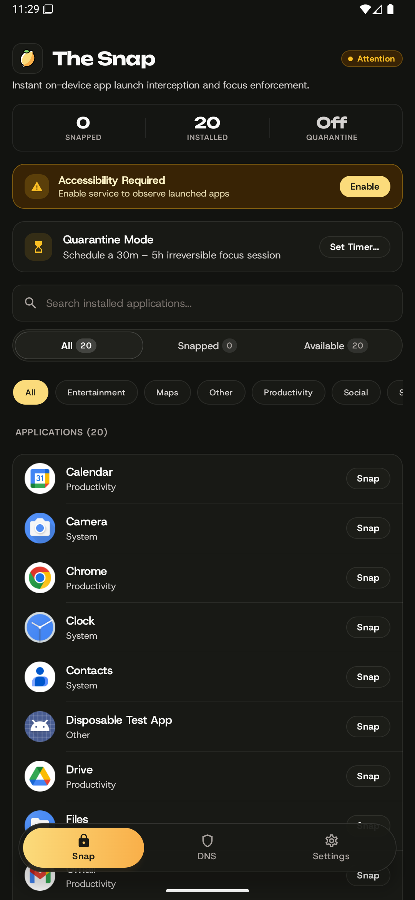
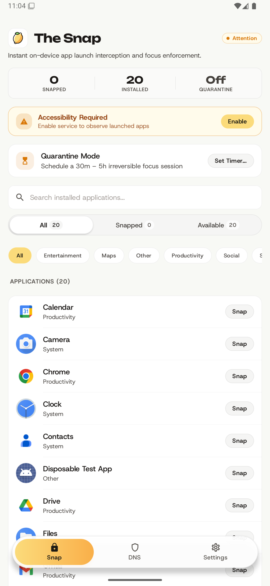
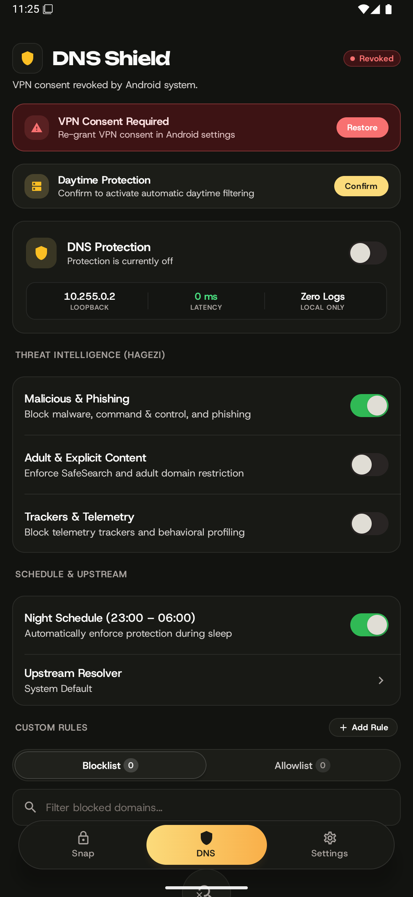
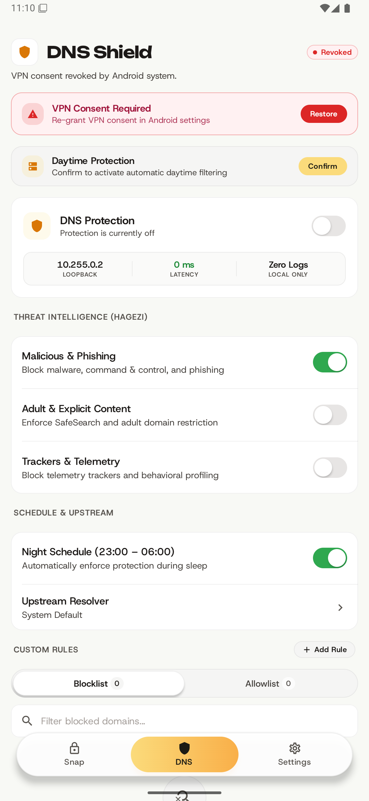
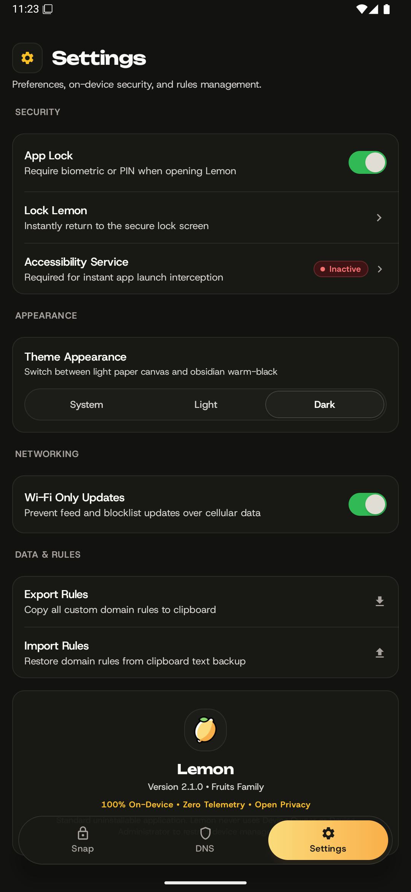
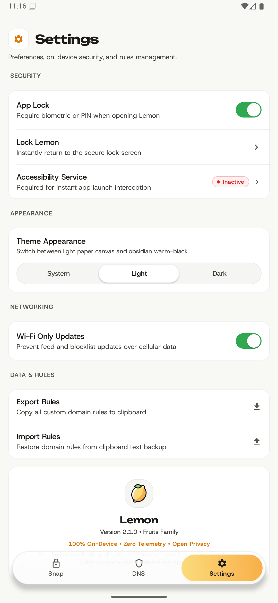
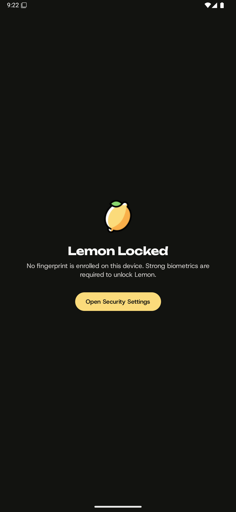
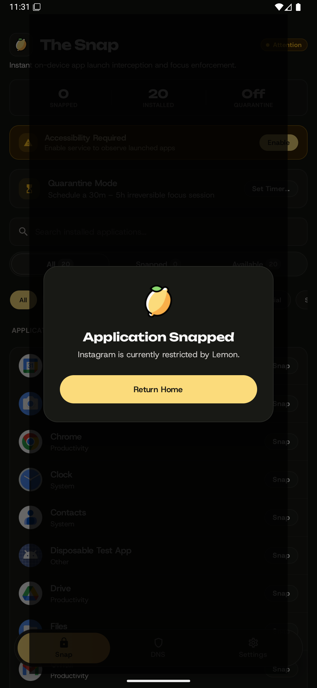

<div align="center">
  

  # Lemon

  **Quiet, Private Android Self-Control & Local DNS Protection Workspace**

  *An authoritative member of the Fruits product family featuring zero-latency foreground app interception, tamper-resistant 30-day delayed policy reconciliation, local loopback DNS threat blocking, and a precision quiet-utility interface built with Jetpack Compose.*

  <br />

  [-3DDC84?style=flat-square&logo=android)](https://developer.android.com)
  [](https://kotlinlang.org/)
  [](https://developer.android.com/jetpack/compose)
  [-FFA000?style=flat-square)](https://developer.android.com/training/data-storage/room)
  [](#3-local-dns-engine)
  [](https://github.com/hagezi/dns-blocklists)
  [](#-privacy--security-model)
  [](LICENSE)

  <br />

  <p align="center">
    <a href="#-overview">Overview</a> •
    <a href="#-fruits-ecosystem--design-system">Design System</a> •
    <a href="#-core-capabilities">Capabilities</a> •
    <a href="#-technical-architecture">Architecture</a> •
    <a href="#-building-from-source">Build & Install</a> •
    <a href="#-verification--testing">Verification</a> •
    <a href="#-privacy--security-model">Privacy & Security</a>
  </p>
</div>

---

## 🌟 Overview

**Lemon** is a modern, privacy-first Android personal self-control and local DNS filtering utility. Built strictly within the **Fruits** design philosophy alongside **Banana** and **Kiwi**, Lemon combines an obsessive focus on quiet, distraction-free utility with robust, on-device enforcement mechanisms.

Lemon operates entirely on your physical device. It requires **zero accounts, zero subscriptions, zero cloud telemetry, zero remote servers, no root access, and no Shizuku daemon**.

### Why Lemon?

* ⚡ **Zero-Latency The Snap** — Detects foreground transitions in real time via an Android `AccessibilityService` (`SnapAccessibilityService`) and triggers an immediate return to the launcher with 0ms artificial delay.
* ⏳ **Quarantine & 30-Day Delay Mechanism** — Put impulsive or addictive applications in a probationary quarantine. Removal or whitelist modifications mandate an irreversible 30-day pending countdown to defeat impulsive habit relapses.
* 🛡️ **Local Loopback DNS Firewall** — Intercepts UDP port 53 DNS queries via a local virtual `VpnService` TUN interface (`10.255.0.2` / `fd00::2`). Non-DNS traffic is never captured, leaving device network throughput and latency untouched.
* 🔒 **Strict Mode with Tamper Prevention** — Protects core device settings and accessibility toggles using bounded accessibility tree inspection and PBKDF2 passcode verification with 100,000 iterations.
* 🌿 **Fruits Ecosystem Cohesion** — Shares typography, component proportions, metric wells, high-contrast segmented pill controls, floating glass capsules, and semantic warm-palette tokens with Banana and Kiwi.

---

## 📸 Visual Tour & Showcase

### 1. The Snap Dashboard (App Launch Interception)

| Dark Obsidian Canvas | Light Warm Paper Canvas |
| :---: | :---: |
|  |  |

### 2. Local DNS Protection & HaGeZi Feeds

| Dark Obsidian Canvas | Light Warm Paper Canvas |
| :---: | :---: |
|  |  |

### 3. Settings & Fruits Ecosystem

| Dark Obsidian Canvas | Light Warm Paper Canvas |
| :---: | :---: |
|  |  |

### 4. Biometric App Lock & Intercepted Overlay

| Biometric App Lock Screen | Application Intercepted Dialog |
| :---: | :---: |
|  |  |

---

## 🎨 Fruits Ecosystem & Design System

Lemon implements the authoritative design specification documented across the Fruits application suite (`Basket/docs/UI`):

### 1. Palette & Surface Tokens

| Token | Light Theme | Dark Theme (Obsidian) | Role / Usage |
| :--- | :--- | :--- | :--- |
| **Canvas** | `#F8F9F5` (Warm Cream White) | `#121310` (Obsidian Warm Black) | Application window root background |
| **Card Surface** | `#FFFFFF` | `#181915` (Lifted Obsidian) | Screen cards, grouped containers, wells |
| **Card Border** | `1px rgba(0, 0, 0, 0.06)` | `1px rgba(255, 255, 255, 0.08)` | Subtle boundary separation |
| **Primary Accent** | `#FBDB7B` (Lemon Yellow) | `#FBDB7B` (Lemon Yellow) | Active indicators, focus rings, brand badges |
| **Accent Text** | `#1C1B14` (Deep Ink) | `#1C1B14` (Deep Ink) | Text on primary lemon accent surfaces (always dark) |
| **Secondary Accent** | `#F9AF49` / `#D97706` (Amber) | `#F9AF49` / `#D97706` (Amber) | Pending 30-day requests, warnings, badges |
| **Success / Protection** | `#89D66D` / `#2FA84F` (Leaf Green)| `#89D66D` / `#2FA84F` (Leaf Green)| Active switches, secure states, protected counts |
| **Danger / Blocked** | `#DC2626` (Red) | `#EF4444` (Red) | Denied rules, blocked attempt counters, resets |
| **Text Primary** | `#1C1B14` | `#EDEDED` | Headings, primary labels, values |
| **Text Secondary** | `#6B7280` | `#9CA3AF` | Supporting descriptions, timestamps |
| **Text Muted** | `#9CA3AF` | `#6B7280` | Eyebrow captions, auxiliary notes |

### 2. Typography Hierarchy

* **Display & Hero Headings**: `Unbounded` (Bold, SemiBold, Medium)  
  * Used for screen titles, metric values, hero banners, and brand headers (`fontSize: 20sp–28sp`, tight tracking `-0.02em`).
* **Interface & Body Typography**: `Host Grotesk` (Regular, Medium, SemiBold, Bold)  
  * Used for section eyebrows, body descriptions, list item labels, input fields, and pill chips (`fontSize: 11sp–16sp`).

### 3. Precision UI Component Library

Lemon replaces standard Material rectangles with bespoke, responsive Fruit components:

* **`FloatingBottomBar`**: A 56dp translucent glass capsule (`RoundedCornerShape(28.dp)`) floating 20dp above the gesture navigation bar with real-time horizontal pill slide tracking.
* **`LemonCard` & `LemonGroupedContainer`**: 16dp rounded card containers with hairline borders, optional interactive feedback, and inset divider management.
* **`LemonMetricWell`**: Compact stat widgets displaying hero count metrics with Unbounded numerals and Host Grotesk micro-labels.
* **`LemonSegmentedControl`**: High-contrast sliding pill selector with integrated numerical badges.
* **`LemonSwitch`**: Custom 48dp tactile toggle with spring animation and leaf-green active state.
* **`LemonSearchField`**: 12dp search bar featuring clear action and two-tier focus ring.
* **`LemonBadge`**: Pill chips with pulse status dots for runtime telemetry.
* **`LemonFeedbackBanner`**: Transient top-docked glass notification capsule for confirmations.

---

## ⚡ Core Capabilities

### 1. The Snap (Foreground Launch Interception)
* **Foreground Window Monitoring**: Leverages `SnapAccessibilityService` to listen for `TYPE_WINDOW_STATE_CHANGED` events across package boundaries.
* **Immediate Dismissal**: Executes `GLOBAL_ACTION_HOME` the millisecond an intercepted application enters the foreground.
* **Dual Feedback Channel**: Dispatches a minimal, distraction-free `BlockedAppActivity` or an accessibility overlay fallback (`TYPE_ACCESSIBILITY_OVERLAY`) if direct Activity dispatch is constrained by the OS.
* **Package Reconciliation**: When apps are uninstalled and later re-installed, Lemon's `PackageReconcileReceiver` immediately recognizes the package from the Room database and restores Snap enforcement.
* **Protected System Components**: System dialers, launchers, input methods, and Android Settings are guarded against accidental interception.

### 2. Quarantine Mode & 30-Day Delay Mechanism
* **Probationary App Isolation**: Apps flagged for quarantine remain blocked until their scheduled quarantine period expires.
* **Tamper-Resistant Countdown**: Removing an app or unlocking a blocked domain requires filing an unlock request that enters an un-skippable 30-day countdown timer (`System.currentTimeMillis() + 30.days`).
* **Habit Rewiring**: By eliminating the instant gratification of unblocking, impulsive social media checks and algorithmic scrolling habits are broken permanently.

### 3. Local DNS Engine
* **Virtual TUN Interface**: Uses Android `VpnService` (`CoconutVpnService`) to create a DNS-only loopback tunnel (`10.255.0.1/32` IPv4, `fd00::1/128` IPv6).
* **Port-53 UDP Processing**: Receives and parses raw DNS UDP queries entirely in memory.
* **Synthetic NXDOMAIN**: Domains matching active blocklists immediately receive locally constructed RFC 1035 `NXDOMAIN` responses—zero network requests leak to external servers.
* **RFC 2460 / RFC 8200 Checksums**: Dynamically calculates IPv4 header and IPv6 pseudo-header UDP checksums for standard RFC compliance.
* **TCP RST Generation**: Does not run an unnecessary TCP state machine; when clients attempt TCP port 53 connections, Lemon responds with a TCP RST to cleanly fallback to UDP.
* **Non-VPN Physical Forwarding**: Permitted queries route through the device's physical network via `DnsResolver.rawQuery` bound to `NET_CAPABILITY_NOT_VPN` to eliminate tunnel loops.
* **Zero Logging**: DNS query history is never written to disk or recorded.

### 4. Bundled Threat Intelligence Feeds
Lemon embeds high-confidence feeds curated by HaGeZi:
* 🛡️ **HaGeZi TIF Mini**: Built-in protection against malware, phishing, scamming, and command-and-control servers.
* 🔞 **HaGeZi Adult (NSFW)**: Blocking pornographic and adult content networks.
* 🚫 **HaGeZi Multi PRO Mini**: Blocking intrusive advertisers, telemetry trackers, and behavioral analytics.
* 🔄 **Atomic Live Updates**: Update blocklist feeds directly from HaGeZi's upstream GitHub repositories with one tap.

### 5. App Lock & Strict Mode
* **Biometric & Passcode Lock**: Protect Lemon's configuration with device biometric authentication (`BiometricPrompt`) or secure passcode fallback.
* **PBKDF2 Key Derivation**: Passcodes are protected using `PBKDF2WithHmacSHA256` with 100,000 iterations and a cryptographically secure 16-byte random salt.
* **Settings Node Inspection**: When Strict Mode is active, Lemon monitors Android Settings hierarchy traversal to prevent tampering with accessibility permissions or VPN configurations.
* **Irreversible Emergency Countdown**: Disabling Strict Mode requires initiating a 15-minute emergency timer before the 10-minute modification window opens.

---

## 🏗️ Technical Architecture

Lemon follows modern Android architecture principles with unidirectional data flow (UDF):

```
┌────────────────────────────────────────────────────────┐
│              Jetpack Compose UI Layer                  │
│   SnapScreen  │  DnsScreen  │  SettingsScreen  │  Lock │
│     Unbounded Typography  •  Host Grotesk Body         │
│     Fruit Design Tokens   •  Floating Bottom Bar       │
└───────────────────────────┬────────────────────────────┘
                            │ StateFlow / Events
┌───────────────────────────▼────────────────────────────┐
│                  MainViewModel                         │
│  State Management • Policy Coordination • Live Timers  │
└───────┬───────────────────────────────┬────────────────┘
        │                               │
┌───────▼────────────────────────┐      │
│   Persistence Layer (Room 2.6) │      │
│   • LemonDatabase (v5)         │      │
│   • SnapDao, DnsRuleDao        │      │
│   • PendingRequestDao          │      │
└────────────────────────────────┘      │
                                        │
        ┌───────────────────────────────┴────────────────┐
        │                                                │
┌───────▼────────────────────────┐      ┌────────────────▼────────────────┐
│     SnapAccessibilityService   │      │        CoconutVpnService        │
│ • Foreground Window Transition │      │ • Local TUN Loopback Interface  │
│ • Zero-Latency Return Home     │      │ • In-Memory Packet Parser       │
│ • Settings Anti-Tamper Guard   │      │ • HaGeZi Domain Bloom Resolvers │
└────────────────────────────────┘      └─────────────────────────────────┘
```

* **Package ID**: `com.coconut` (manifest-declared, backwards-compatible across app upgrades).
* **Target SDK**: Android 16 (API Level 36).
* **Minimum SDK**: Android 10 (API Level 29).
* **On-Device Storage**: SQLite via Android Room v5 with automated schema migrations.

---

## 🛠️ Building from Source

### Prerequisites

* **JDK**: Version 17 LTS (Adoptium Temurin or Android Studio bundled OpenJDK).
* **Android SDK**: Build-Tools `35.0.0` or `34.0.0`, Platform SDK `36` / `35`.
* **Gradle**: Gradle 8.11.1 (managed via included `gradlew` wrapper).

### 1. Compile & Assemble Debug APK

To compile and package the debug APK:

```powershell
.\gradlew.bat assembleDebug
```

* **Output Artifact**: `app/build/outputs/apk/debug/app-debug.apk`
* **Application ID**: `com.coconut.debug` (installs side-by-side with production)

### 2. Compile & Assemble Release APK

To compile, optimize with R8, and package the release APK:

```powershell
.\gradlew.bat assembleRelease
```

* **Output Artifact**: `app/build/outputs/apk/release/app-release.apk`
* **Application ID**: `com.coconut`

### 3. Keystore & Signing Configuration Precedence

Release builds require cryptographic signing. Lemon resolves credentials through the following hierarchical order:

1. **Environment Variables**:
   * `COCONUT_KEYSTORE_PATH`
   * `COCONUT_KEYSTORE_PASSWORD`
   * `COCONUT_KEY_ALIAS`
   * `COCONUT_KEY_PASSWORD`
2. **Git-Ignored `local.properties`**:
   ```properties
   COCONUT_KEYSTORE_PATH=C:/path/to/keystore/lemon-release.jks
   COCONUT_KEYSTORE_PASSWORD=your_keystore_password
   COCONUT_KEY_ALIAS=your_key_alias
   COCONUT_KEY_PASSWORD=your_key_password
   ```
3. **Secure User Directory Default**:
   * `~/.coconut/keystore/coconut-release.jks`

> [!NOTE]
> If signing credentials are not configured, `assembleRelease` fails explicitly with a clear configuration message rather than producing an insecure, unverified package.

---

## 🧪 Verification & Testing

Lemon maintains a comprehensive suite of unit tests covering the core enforcement engines and data layer:

### Run All Unit Tests

```powershell
.\gradlew.bat test
```

### Verified Test Suites

* **`LemonPolicyCoordinatorTest`**: Verifies 30-day pending request lifecycles, timer countdown arithmetic, and state transitions.
* **`DnsPacketParserTest`**: Verifies raw UDP DNS packet decoding, IPv4/IPv6 synthetic response generation, and RFC checksum calculations.
* **`DatabaseMigrationTest`**: Validates Room database schema integrity across versions 1 through 5.
* **`QuarantineTest`**: Confirms quarantine isolation logic and probation release scheduling.
* **`DnsEngineTest`**: Evaluates HaGeZi prefix matching, IDN / Punycode normalization, and whitelist precedence.

---

## 🔒 Privacy & Security Model

Lemon was engineered with an absolute zero-trust privacy posture:

* 🛡️ **100% On-Device Execution**: Lemon has zero tracking SDKs, zero analytics pings, and zero external crash reporting libraries.
* 🚫 **Zero Query Retention**: DNS queries are evaluated transiently in volatile RAM and immediately discarded. No lookup history or visited domain logs exist.
* 📦 **Non-Destructive Enforcement**: Lemon never deletes user files, modifies system partitions, or clears third-party application storage.
* 🔓 **Clean Uninstallation**: Lemon uses no hidden administrator device owner locks. You can deactivate Accessibility and VPN services at any time and uninstall the application cleanly.

---

<div align="center">
  <sub>Part of the <b>Fruits</b> product family • Crafted with Jetpack Compose & Kotlin</sub>
</div>
