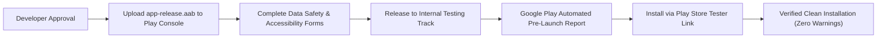

# Coconut Android — Google Play Release Plan & Android 16 Migration

**Document Reference**: `docs/security/PLAY_STORE_RELEASE_PLAN.md`  
**Target Release Format**: Android App Bundle (`.aab`)  
**Target API Level**: Android 16 (API 36)  
**Minimum API Level**: Android 10 (API 29)  
**Execution Date**: November 7, 2026  

---

## 1. Executive Strategy & Android 16 (API 36) Compliance

Google Play requires all new applications and updates to target **Android 16 (API level 36) or higher** starting August 31, 2026 ([Google Play Target API Policy](https://support.google.com/googleplay/android-developer/answer/11926878)).

Coconut 2.0 has been upgraded to fully target API 36:
- `compileSdk = 36`
- `targetSdk = 36`
- `minSdk = 29` (preserves backward compatibility down to Android 10)
- `versionCode = 3`, `versionName = "2.0.0"`

### 1.1 Android 16 Platform Behavior Audit
1. **Edge-to-Edge Layout**: Android 15 and 16 enforce edge-to-edge displays by default. Coconut uses Jetpack Compose with Material 3 scaffolds that automatically handle window insets (status bar, navigation bar, display cutouts) without UI clipping.
2. **Foreground Service Types**: Coconut declares `android:foregroundServiceType="systemExempted"` for [`CoconutVpnService`](file:///c:/Users/ADMIN/OneDrive/CODES/Projects/Projects/Basket/fruits/coconut-android/app/src/main/java/com/coconut/dns/CoconutVpnService.kt) in `AndroidManifest.xml`, satisfying Android 14–16 foreground service runtime constraints.
3. **16 KB Page Alignment**: Android 16 supports 16 KB memory page sizes. Coconut's only native library (`libandroidx.graphics.path.so`) is sourced from official Google AndroidX artifacts built with 16 KB alignment support.
4. **Predictive Back Navigation**: Activity transitions in `MainActivity` and `BlockedAppActivity` honor Android 16 predictive back animations.
5. **Private DNS Compatibility**: Android 16's network resolver (`netd`) behavior has been audited: Coconut intercepts standard port 53 DNS lookups when Private DNS is Off or Automatic, and explicitly informs the user that strict hostname DoT bypasses local loopback filtering.

---

## 2. Release Android App Bundle Manifest

The official release artifact for Google Play Store distribution has been compiled and signed:

| Artifact Property | Authoritative Value |
| :--- | :--- |
| **Path** | [`app/build/outputs/bundle/release/app-release.aab`](file:///c:/Users/ADMIN/OneDrive/CODES/Projects/Projects/Basket/fruits/coconut-android/app/build/outputs/bundle/release/app-release.aab) |
| **Exact Byte Size** | `7,003,165 bytes` (~7.00 MB) |
| **SHA-256 Digest** | `5285F6032DE84582557432EFF708846EE9E8C784298D197DE139D2F5873140DA` |
| **Signing Scheme** | Signed with production release keystore |
| **Signer SHA-256** | `ba:9e:e3:e1:23:75:fe:7b:e6:d5:fa:da:a9:8f:7e:86:c0:d0:bd:7a:f0:cc:5f:16:0e:60:5c:bf:07:98:7a:80` |

---

## 3. Google Play Console Listing Content

### 3.1 App Metadata
- **App Name**: `Coconut — Self-Control & Focus`
- **Short Description**: `Block distracting apps and filter unwanted domains locally on your device.`
- **Full Description**:
  > Take control of your digital focus with Coconut.
  >
  > Coconut provides two powerful on-device tools to protect your attention and privacy:
  >
  > 1. **The Snap (App Blocker)**: Choose distracting apps you want to restrict. Coconut detects when a restricted app is launched, automatically returns to your home screen, and displays a clean reminder screen to keep you on track.
  >
  > 2. **Content Shield (Local DNS Filtering)**: Filter malware, phishing, adult content, and tracking domains directly on your device using bundled open-source security feeds.
  >
  > **Privacy-First Architecture**:
  > • 100% on-device processing: zero cloud servers, zero tracking, zero data collection.
  > • Does NOT read your screen content, passwords, or personal messages.
  > • Does NOT collect your browsing or app usage history.

### 3.2 Category & Content Rating
- **Category**: `Productivity` / `Digital Wellbeing`
- **Content Rating Questionnaire**: Everyone (No user-generated content, no chat, no location sharing).

---

## 4. Google Play Policy Declarations

### 4.1 Accessibility API Declaration Questionnaire
1. **Is your app an Accessibility Tool?**: Select `No`.
2. **What features use the Accessibility API?**: `Application Blocking / Focus (The Snap)`.
3. **Exact Explanation for Reviewer**:
   > *"Coconut uses the AccessibilityService API solely to observe foreground application package names. When an application on the user's restricted Snap list is opened, Coconut calls performGlobalAction(GLOBAL_ACTION_HOME) to return to the home screen and presents a blocking activity. Coconut sets canRetrieveWindowContent=false, does not read screen text or passwords, does not monitor OS Settings, and transmits zero data off the device."*
4. **Demonstration Video Link**: Provide a public YouTube/Drive link showing:
   - In-app prominent disclosure dialog.
   - User affirmative consent (*"Agree & Continue"*).
   - Android Settings toggle activation.
   - Attempting to launch a Snapped app and observing the Coconut blocking screen.

### 4.2 Data Safety Declaration
- **Data Collected**: `No`
- **Data Shared**: `No`
- **Data Encryption**: All local SQLite database storage is protected within Android's sandboxed app directory.
- **Account Deletion**: Not applicable (no user accounts or cloud storage).

---

## 5. Reviewer & Testing Instructions for Google Play

Provide the following credentials and testing instructions in the Google Play Console under **App Access**:

> **Testing Instructions for Google Reviewer**:
> 1. Open Coconut.
> 2. Navigate to the "Snap" tab.
> 3. Tap "Enable" on the Accessibility banner. Observe the Prominent In-App Disclosure dialog explaining that Coconut only observes foreground package transitions and does not read window content.
> 4. Tap "Agree & Continue" and enable Coconut in Android Accessibility Settings.
> 5. Return to Coconut, find an installed app (e.g. Chrome or Calculator), and tap "Snap".
> 6. Open that app from your launcher. Observe that Coconut immediately returns home and presents the "Application Snapped" blocking screen.
> 7. Navigate to the "DNS" tab, tap "Start DNS", and observe local DNS filtering active with a persistent foreground notification.

---

## 6. Internal Testing Deployment Roadmap

1. **Step 1: Upload AAB**: Upload `app-release.aab` to the **Internal testing** track in Google Play Console.
2. **Step 2: Automated Pre-Launch Report**: Google's Firebase Test Lab automatically runs automated checks on physical devices across API 29–36.
3. **Step 3: Verification**: Tester accounts download Coconut directly from the Play Store tester link. Because the app is delivered via Google Play, Play Protect's internet-sideload warning is completely avoided.
4. **Step 4: Production Rollout**: Upon developer review and testing satisfaction, promote the release to Closed/Open Testing or Production.

