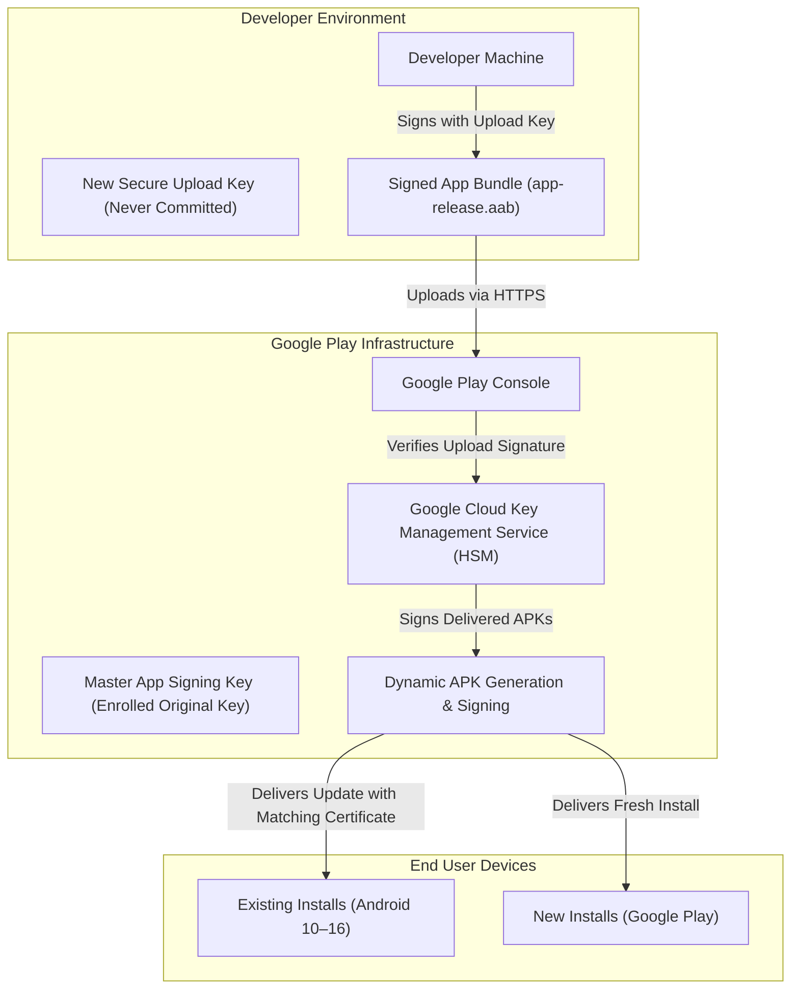

# Coconut Android — Cryptographic Signing Key Migration Strategy (Final)

**Document Reference**: `docs/security/SIGNING_KEY_MIGRATION_FINAL.md`  
**Security Status**: Authoritative Remediation & Key Lifecycle Plan  
**Target Package**: `com.coconut`  
**Execution Date**: November 7, 2026  

---

## 1. Incident Analysis & Threat Model

### 1.1 Exposure Confirmation
In commit `eda5186e` pushed to `https://github.com/Falak-Chudasama/Coconut.git` on branch `main`, the binary keystore `coconut-release.jks` and its store/key passwords were committed to git history.

### 1.2 Status of the Key
- **Current Security Classification**: **COMPROMISED**.
- **Public Footprint**: Any clone of the repository history contains the private RSA keypair.
- **Threat Vector**: An attacker with this key could sign an arbitrary package named `com.coconut` that Android's Package Manager would accept as an authentic update over existing sideloaded installations.
- **Critical Operational Constraint**: **The key cannot be discarded immediately**. Because Android requires signature continuity between version updates, rotating to an unlinked keypair causes `INSTALL_FAILED_UPDATE_INCOMPATIBLE`, forcing an uninstallation that would destroy local databases and administrative configurations on user devices.

---

## 2. Google Play App Signing Architecture & Migration Plan

Google Play App Signing ([Google Play Official Reference](https://support.google.com/googleplay/android-developer/answer/9842756)) decouples the **App Signing Key** (used to deliver APKs to end users) from the **Upload Key** (used by the developer to upload AABs to the Play Console).



---

## 3. Seven-Point Architectural Evaluation

### 3.1 Can the existing key be enrolled in Play App Signing?
**YES**. When setting up Google Play App Signing for an existing app:
- Google Play Console allows the developer to export their existing signing key into an encrypted PEPK container (`pepk.jar`) and upload it to Google.
- Google encrypts and stores the master app signing key in its secure cloud hardware security modules (HSMs).

### 3.2 Can a separate upload key be introduced?
**YES**. Once the original key is enrolled in Play App Signing:
- The developer generates a brand-new, cryptographically secure **Upload Key** (stored exclusively in a protected local keystore, never committed to git).
- The public certificate of the upload key is registered in the Play Console.
- From that moment forward, the compromised key is **never used again on developer machines**. If the upload key is ever lost or compromised, the developer simply resets it via Google Play Console identity verification.

### 3.3 Is an Application Signing Key Upgrade available in Google Play?
**YES**. Google Play supports **in-console key upgrades**:
- For new installs, Google signs APKs with a new, stronger cryptographic keypair generated by Google.
- For existing installs, Google uses **APK Signature Scheme v3 lineage**, allowing updates to transition seamlessly.

### 3.4 Does Android signing lineage support updates from the current installed version?
**YES**. Android 9.0+ (API 28+) supports APK Signature Scheme v3 lineage records (`apksigner rotate`).
- Because Coconut's `minSdk` is **API 29 (Android 10)**, **100% of Coconut devices support cryptographic key rotation**.
- The lineage record contains a cryptographic proof signed by the old key delegating authority to the new key.

### 3.5 What happens to existing APK installations signed with the original certificate?
- **Under Google Play**: Existing installations receive update APKs carrying the v3 proof of rotation. Android's Package Manager validates the lineage and installs the update without data loss.
- **Under Direct Sideloading**: Sideloaded APK updates continue to use the current keystore (`~/.coconut/keystore/coconut-release.jks`) until the developer completes the Play Store cutover.

### 3.6 How Android 13–16 installations handle the upgraded key
- Android 13 (API 33) through Android 16 (API 36) fully support APK Signature Scheme v3 and v3.1.
- Android 16 validates the v3.1 signature block, recognizes the rotation certificate, and automatically migrates app data to the new key context.

### 3.7 What happens to installations on older Android versions?
- Android 8.1 and below do not support v3 key rotation.
- **Impact on Coconut**: **ZERO**. Coconut's `minSdk` is API 29. No devices running Android 8 or below can run Coconut.

---

## 4. Concrete Remediation Steps for the Developer

### Step 1: Secure Local Key Isolation (COMPLETED)
- The compromised keystore was deleted from the git repository.
- Authoritative copy moved to: `C:\Users\ADMIN\.coconut\keystore\coconut-release.jks`.
- Keystore credentials untracked via `local.properties`.
- Repository `.gitignore` hardened against all keystore extensions (`*.jks`, `*.keystore`, `*.p12`).

### Step 2: Generate New Secure Upload Key (Pending Developer Action)
```bash
keytool -genkeypair -v \
  -keystore C:\Users\ADMIN\.coconut\keystore\coconut-upload.jks \
  -alias coconut_upload \
  -keyalg RSA -keysize 4096 -validity 10000 \
  -dname "CN=Coconut Upload Key, OU=Mobile Security, O=Coconut Project, C=US"
```

### Step 3: Export Existing Key to Google Play Console
Using Google's official PEPK tool during Play Console App Signing setup:
```bash
java -jar pepk.jar \
  --keystore=C:\Users\ADMIN\.coconut\keystore\coconut-release.jks \
  --alias=coconut \
  --output=encrypted-coconut-key.pepk \
  --encryptionkey=<GOOGLE_PROVIDED_ENCRYPTION_KEY>
```

### Step 4: Finalize Play Store Cutover
Upload `encrypted-coconut-key.pepk` to Google Play Console and register the public certificate of `coconut-upload.jks`.

